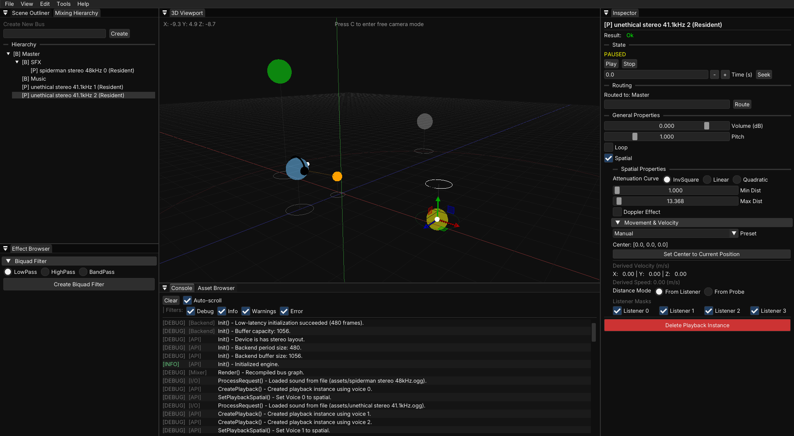

<div align="center">
  
  <br><br>
  <i>Dedicated Abstraction Layer for Interactive Audio in C++</i>

[](https://amhumming.github.io/dalia/)
[](https://github.com/amhumming/dalia/releases)
[](#building-from-source)
[](LICENSE)

</div>

---

## Capabilities

### Concurrency
* Lock-free API with zero mutex contention on the calling thread.
* Asynchronous audio device migration with desync-free timeline preservation.
* Asynchronous, reference-counted asset loading and streaming.

### Spatialization
* Configurable coordinate systems (left/right-handed).
* Multi-listener support with per-playback bitmask routing.
* Decoupled distance probes (independent attenuation and panning origins designed for third-person camera setups).
* Doppler pitch shifts with global and per-playback scaling.

### Routing & DSP
* Crossfaded runtime rerouting of playbacks, buses, and effects.
* Per-bus effect chains with 4 hot-swappable DSP slots.
* Real-time parameter control for volume, playback rate, pan, looping, spatialization, position, attenuation curve, min/max distance, velocity, doppler effect, and more.

## Speaker Configurations
| Configuration | Supported |
|:--------------|:----------|
| **Stereo (2.0)**   | Yes       |
| **Mono (1.0)**     | Yes       |
| **Surround (5.1 / 7.1)**     | No        |

## Sandbox
The standalone sandbox application is designed to showcase and test the engine's features. If you want to
test what the engine is capable of without having to write any code you can try it out by following the build
instructions provided below and running the compiled sandbox executable.

<p align="center">
  
</p>

## Building from Source

### Requirements
* CMake 3.21+
* C++ 20 compliant GCC or MSVC compiler

If you want to compile DALIA directly to run the Sandbox or Studio UI, use the commands below. Please note that DALIA 
Studio tool is currently not in a usable state and is therefore excluded from the build by default.

```bash
git clone https://github.com/amHumminG/dalia.git
cd dalia

cmake -B build
cmake --build build --config Release
```

*The compiled executables will be located in the `/build` directory*

## Integration
Dalia automatically detects when it is built as a subproject and will exclude the sandbox and studio applications from 
the build.

**CMake FetchContent**
```cmake
include(FetchContent)
FetchContent_Declare(
    dalia
    GIT_REPOSITORY https://github.com/amHumminG/dalia.git
    GIT_TAG v0.1.0
)
FetchContent_MakeAvailable(dalia)

target_link_libraries(your_target PRIVATE dalia::engine)
```

**Git Submodule**
```bash
git submodule add -b v0.1.0 https://github.com/amHumminG/dalia.git third_party/dalia
```
```cmake
add_subdirectory(third_party/dalia EXCLUDE_FROM_ALL)
target_link_libraries(your_target PRIVATE dalia::engine)
```

## Profiling with Tracy
Dalia has support for profiling using [Tracy](https://github.com/wolfpld/tracy). To enable profiling in the engine,
configure CMake with:
```bash
cmake -B build -D DALIA_PROFILE_ENABLE=ON
```

## Dependencies
Consuming `dalia::engine` does not transitively expose or require external graphics, GUI or test frameworks.

**Engine:**
* [stb_vorbis](https://github.com/nothings/stb) (MIT License) - Embedded OGG/Vorbis decoder.

**Tooling:**
* [Tracy](https://github.com/wolfpld/tracy) (BSD 3-Clause) - Real-time telemetry and profiling.

**Testing:**
* [GoogleTest](https://github.com/google/googletest) (BSD 3-Clause) - Test suite.

**Sandbox:**
* [raylib](https://github.com/raysan5/raylib) (zlib License) - Window handling and 3D rendering.
* [Dear ImGui](https://github.com/ocornut/imgui) (MIT License) - UI.
* [rlImGui](https://github.com/raylib-extras/rlImGui) (zlib License) - ImGui backend for raylib.
* [ImGuizmo](https://github.com/CedricGuillemet/ImGuizmo) (MIT License) - Immediate-mode 3D spatial transformation gizmos.

## License

Dalia is licensed under the [MIT License](LICENSE).