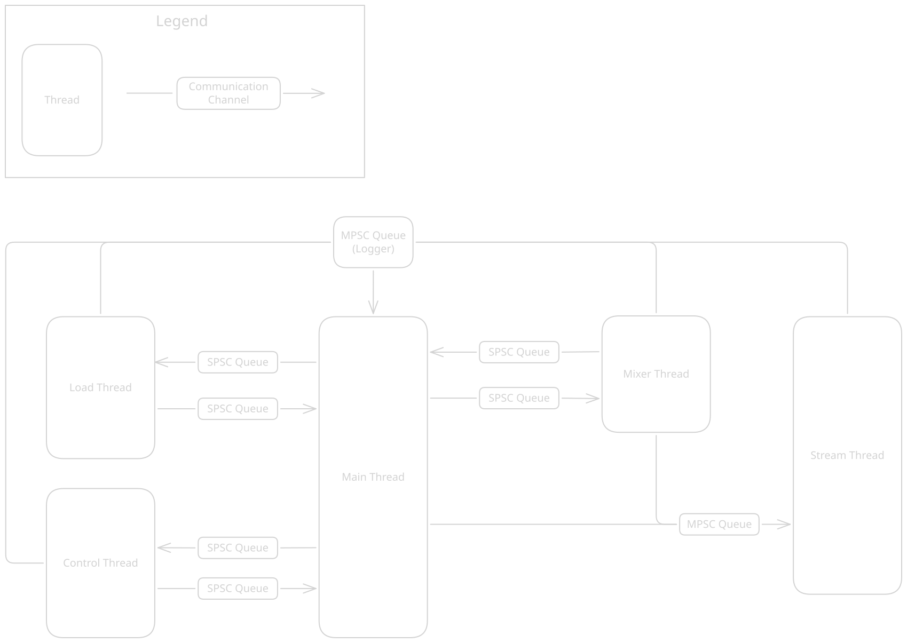
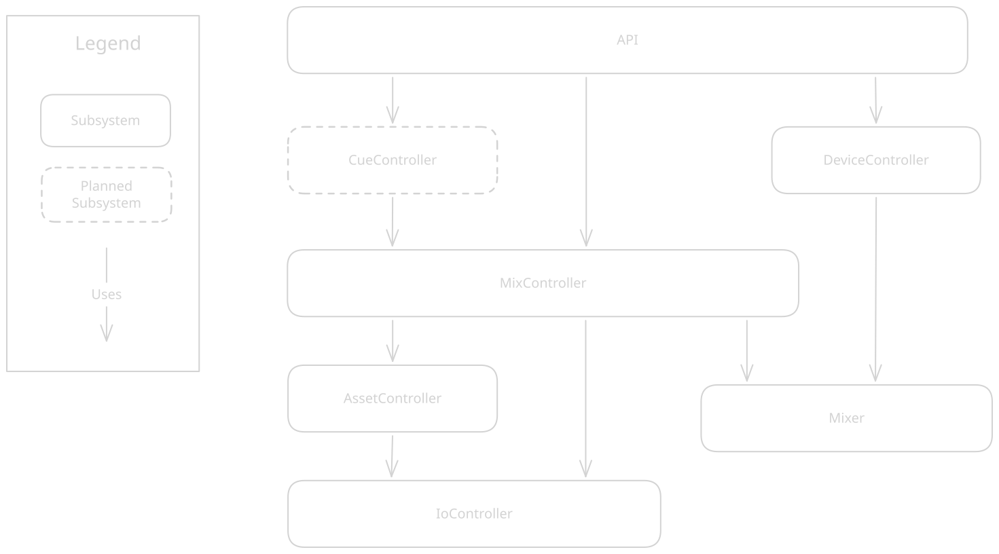
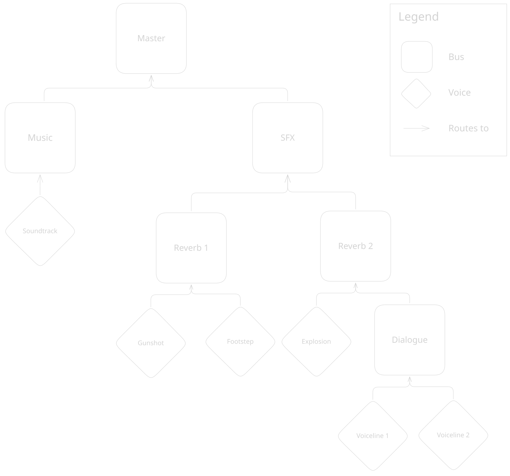
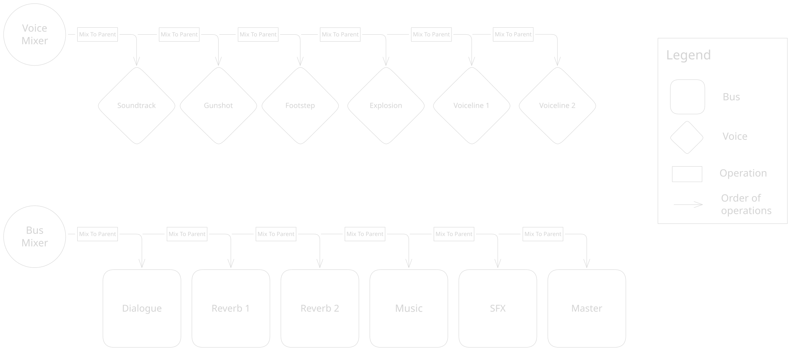

# Architecture

## Threading Model
DALIA splits its processing across five threads in total (one of them being the thread that the API is 
being called from). The engine delegates its workload to three internal subsystems. To do this efficiently without 
locking any of the priority threads (the main thread and the mixer thread), DALIA makes use of lock-free queues 
for most of its inter-thread communication.

### Thread Communication Diagram

The **Main Thread** is where `Engine::Update()` is called. It acts purely as a command dispatcher. When a
call to the engine is made, it is packaged into a command struct and pushed into a lock-free queue. When 
`Engine::Update()` is called, all commands accumulated since the last update call are dispatched to the other
threads for processing.

The **Mixer Thread** is a real-time, high-priority thread. It uses a semaphore to wake up when an audio frame 
has been consumed by the output device.

The **Stream Thread** is a high-priority background worker thread that upon request, fills stream buffers 
with PCM data. This thread wakes up in short intervals.

The **Load Thread** is a normal-priority background worker thread that upon request, opens and reads file 
handles and file data into memory. It uses a semaphore to wake the thread upon receiving a task.

The **Control Thread** is normal-priority a background worker thread that upon request, handles all other tasks that 
can't run on the main thread (e.g. device initialization). It uses a semaphore to wake the thread upon receiving a task.

## Engine Structure

### Class Diagram

The engine consist of multiple subsystems communicating in a strict hierarchical fashion.

- **API** is the user interface that validates requests and routes them directly to internal subsystems.
- **CueController** is a planned intermediate system between the API and MixController. It will handle audio cues,
dynamic containers, and playback rulesets before generating direct mix instructions.
- **MixController** is the central system that bridges and translates higher-level commands into mixer instructions.
It orchestrates all mix nodes and makes use of both AssetController and IoController to ensure that data is properly
loaded and unloaded depending on the mixer state.
- **AssetController** manages the registry of sounds. It relies on IoController for file loading.
- **IoController** is the subsystem handling all I/O operations. This includes asynchronous disk-reading for
file-decoding when loading and streaming from files.
- **DeviceController** handles all interactions with the operating system's audio API. It provides output configurations
for the Mixer, handles device-swap sequences and synchronization.
- **Mixer** The DSP rendering engine. It is responsible for all audio mixing and produces mixed audio into a ring-buffer 
that gets consumed by the active output device.

## Mixing Graph
The DSP pipeline is a Directed Acyclic Graph (DAG). In order to route audio dynamically, every node
(voice or bus) holds a reference (more specifically an index) to its parent node. 

### Mix Graph Diagram

This system is designed for CPU cache efficiency. The engine maintains a flat, topologically sorted array of active nodes.
During an audio frame, the audio thread simply runs through this contiguous array, accumulating audio data into the
correct parent buffers. To achieve this, the engine intentionally trades memory for CPU performance by pre-allocating
intermediate buffers for every bus during initialization.

### Mix Graph Compilation Diagram

Every audio frame is evaluated in multiple passes: 

The **State Resolution Pass** acts as a preparation phase before the actual rendering can take place. During it,
the mixer resolves pending seeks, evaluates ducking and fading for all mix nodes.

During the **Voice Pass**, the engine iterates over all active, playing voices. It reads their audio data and applies
transformations (volume, playback rate, spatialization, and more), and mixes the output into their parent bus.

With the voice data fully accumulated, the **Bus Pass** runs through the topology sorted bus hierarchy. For each bus, it
processes any attached DSP effects, applies volume and mixes the output into its parent bus. This pass finishes when 
all output data is mixed into the Master output.